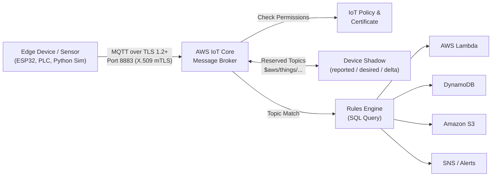
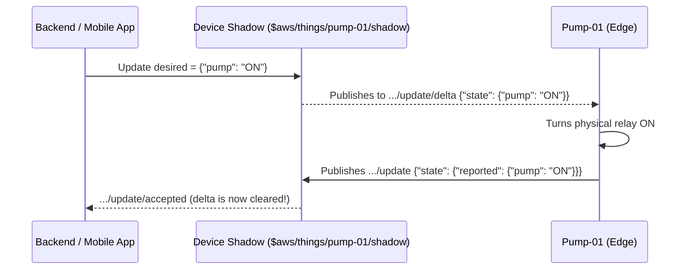

## Why AWS IoT Core Exists (The Mental Model)

> [!MENTAL_MODEL]
> Think of **AWS IoT Core** as a **high-security post office + smart mail sorter** for hardware devices:
> 1. **Security Desk (mTLS + X.509):** Before a sensor can even enter the lobby, it shows a cryptographic passport (X.509 certificate) and checks the post office's passport too.
> 2. **Post Office Counter (MQTT Broker):** Devices drop off lightweight envelopes on named mailboxes called **Topics** (like `plant1/boiler/temp`) and listen for replies on other topics.
> 3. **Smart Mail Sorter (Rules Engine):** Without you running any server, a built-in SQL filter inspects every envelope and routes copies straight to **DynamoDB**, **Lambda**, **S3**, or **SNS**.
> 4. **Sticky Note Board (Device Shadow):** Even when a device loses Wi-Fi in a basement, apps can still read its last known state and leave a "desired" instruction waiting for when it wakes up.

---

## Core Architecture at a Glance



---

## The 5 Building Blocks You Must Know

| Component | What It Actually Is | Real-World Analogy |
| :--- | :--- | :--- |
| **Thing** | A JSON record in the AWS IoT Registry (`name`, attributes like `serial`, `firmware`) | Employee profile in HR |
| **X.509 Certificate** | Public/private key pair + signed cert stored on the device | Physical security badge |
| **IoT Policy** | JSON permissions (`iot:Connect`, `iot:Publish`, `iot:Subscribe`, `iot:Receive`) attached to a Certificate | Which doors the badge opens |
| **Message Broker** | Serverless MQTT/WSS/HTTPS pub-sub hub handling millions of connections | The post office router |
| **Rules Engine** | SQL query + Action pipeline triggered on matching MQTT topics | Automated mail forwarding rules |

> [!WARNING]
> **Critical Gotcha #1 — Attaching Policy to Certificate vs Thing:**
> In AWS IoT Core, **IoT Policies are attached to the Certificate**, and the **Certificate is attached to the Thing**. A Thing without an active, policy-backed certificate cannot connect!

> [!WARNING]
> **Critical Gotcha #2 — QoS Support:**
> AWS IoT Core supports **QoS 0** (fire-and-forget) and **QoS 1** (at least once with `PUBACK`). **QoS 2 is NOT supported** — sending QoS 2 causes the broker to disconnect your client immediately.

---

## Designing Clean MQTT Topics

Good topic structure makes Rules Engine queries and IoT Policies 10x easier later:

```text
<tenant>/<site>/<device-type>/<thing-name>/<message-type>
```

Examples:
- `acme/chennai-plant/boiler/boiler-01/telemetry` (Device -> Cloud)
- `acme/chennai-plant/boiler/boiler-01/commands` (Cloud -> Device)
- `acme/chennai-plant/boiler/+/telemetry` (Subscribe wildcard: single level `+`)
- `acme/chennai-plant/#` (Subscribe wildcard: multi-level `#`, only valid at the end!)

> [!TIP]
> Avoid starting custom topics with `$`! Topics starting with `$aws/` are reserved by AWS for services like **Device Shadow** and **IoT Jobs**.

---

## Least-Privilege IoT Policy Template

Never leave `"Resource": "*"` in production. Use **policy variables** like `${iot:Connection.Thing.ThingName}` so one shared policy template automatically locks each device to its own topics:

```json
{
  "Version": "2012-10-17",
  "Statement": [
    {
      "Effect": "Allow",
      "Action": ["iot:Connect"],
      "Resource": "arn:aws:iot:ap-south-1:123456789012:client/${iot:Connection.Thing.ThingName}"
    },
    {
      "Effect": "Allow",
      "Action": ["iot:Publish", "iot:Receive"],
      "Resource": "arn:aws:iot:ap-south-1:123456789012:topic/devices/${iot:Connection.Thing.ThingName}/*"
    },
    {
      "Effect": "Allow",
      "Action": ["iot:Subscribe"],
      "Resource": "arn:aws:iot:ap-south-1:123456789012:topicfilter/devices/${iot:Connection.Thing.ThingName}/*"
    }
  ]
}
```

> [!REALWORLD]
> Notice the subtle difference between `iot:Publish`/`iot:Receive` (uses `:topic/...`) and `iot:Subscribe` (uses `:topicfilter/...`). Mixing those two up is one of the top reasons subscriptions silently fail!

---

## How Device Shadow Works (Step-by-Step)



Key reserved topics for a Thing named `pump-01`:
- `$aws/things/pump-01/shadow/update` — publish `desired` or `reported` state
- `$aws/things/pump-01/shadow/update/delta` — device subscribes here to receive only what changed
- `$aws/things/pump-01/shadow/get` — publish `{}` on boot to fetch full current shadow

---

## Hands-On Lab: Simulate a Real Device & Route Data

In this practical lab, you will use the **AWS CLI** and a **Python simulator** (no physical hardware needed!) to connect to AWS IoT Core over mTLS and test live MQTT messaging.

### Part A — Provision Thing, Cert, and Policy (AWS CLI)

- [ ] **Step 1:** Check your AWS IoT Core custom data endpoint (you'll connect your device to this host):

```bash
aws iot describe-endpoint --endpoint-type iot:Data-ATS
```

- [ ] **Step 2:** Create a Thing named `sim-sensor-01` in the Registry:

```bash
aws iot create-thing --thing-name sim-sensor-01
```

- [ ] **Step 3:** Generate an X.509 certificate + private key and save them locally (keep `private.pem.key` secret!):

```bash
mkdir -p certs
aws iot create-keys-and-certificate \
  --set-as-active \
  --certificate-pem-outfile certs/device.pem.crt \
  --public-key-outfile certs/public.pem.key \
  --private-key-outfile certs/private.pem.key
```

- [ ] **Step 4:** Download the Amazon Root CA 1 certificate so your device trusts the AWS broker:

```bash
curl -o certs/AmazonRootCA1.pem https://www.amazontrust.com/repository/AmazonRootCA1.pem
```

- [ ] **Step 5:** Create a scoped IoT Policy (`LabDevicePolicy`) and attach it to the certificate ARN returned in Step 3:

```bash
aws iot create-policy \
  --policy-name LabDevicePolicy \
  --policy-document '{"Version":"2012-10-17","Statement":[{"Effect":"Allow","Action":"iot:*","Resource":"*"}]}'

# Replace <CERT_ARN> with certificateArn from Step 3
aws iot attach-policy --policy-name LabDevicePolicy --target "<CERT_ARN>"
aws iot attach-thing-principal --thing-name sim-sensor-01 --principal "<CERT_ARN>"
```

### Part B — Publish & Subscribe via Python (`awsiotsdk`)

- [ ] **Step 6:** Install the official AWS IoT Device SDK v2 for Python:

```bash
pip install awsiotsdk
```

- [ ] **Step 7:** Open **AWS IoT Console -> MQTT Test Client**, subscribe to `devices/sim-sensor-01/telemetry`, and run this Python script:

```python
import json
import time
from awscrt import mqtt
from awsiot import mqtt_connection_builder

ENDPOINT = "YOUR_ENDPOINT-ats.iot.ap-south-1.amazonaws.com"
CLIENT_ID = "sim-sensor-01"
TOPIC = f"devices/{CLIENT_ID}/telemetry"

conn = mqtt_connection_builder.mtls_from_path(
    endpoint=ENDPOINT,
    cert_filepath="certs/device.pem.crt",
    pri_key_filepath="certs/private.pem.key",
    ca_filepath="certs/AmazonRootCA1.pem",
    client_id=CLIENT_ID,
)

print("Connecting to AWS IoT Core...")
conn.connect().result()
print("Connected!")

for i in range(5):
    payload = {
        "deviceId": CLIENT_ID,
        "temperatureC": round(24.5 + i * 0.7, 2),
        "humidity": 58,
        "ts": int(time.time()),
    }
    conn.publish(
        topic=TOPIC,
        payload=json.dumps(payload),
        qos=mqtt.QoS.AT_LEAST_ONCE,
    )
    print("Published:", payload)
    time.sleep(2)

conn.disconnect().result()
```

- [ ] **Step 8:** Create a Rules Engine Rule in the Console (`SELECT * FROM 'devices/+/telemetry' WHERE temperatureC > 25`) and attach an action (e.g., **CloudWatch Logs** or **Lambda**) to verify serverless routing!

- [ ] **Step 9 (Cleanup):** Delete your test Thing/Policy/Certificate after finishing so your account stays tidy.

---

## Quick Cheat Sheet

| Question | Answer |
| :--- | :--- |
| Standard MQTT port over mTLS? | `8883` |
| MQTT over WebSockets (SigV4 / Custom Auth)? | `443` |
| Max MQTT payload size in AWS IoT Core? | `128 KB` |
| Max QoS supported? | `QoS 1` (No QoS 2!) |
| What authenticates a device? | X.509 Certificate (or Custom Authorizer / Cognito) |
| What authorizes MQTT actions? | IoT Policy attached to the Certificate |
